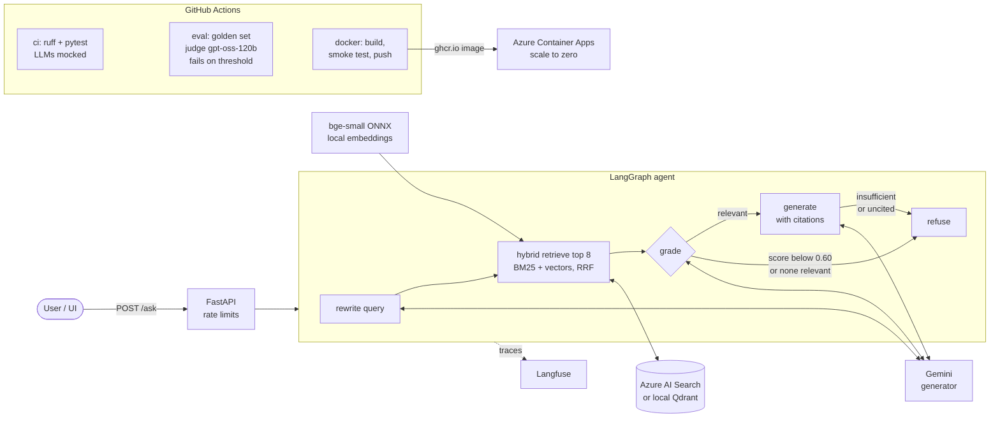

# EU Rail Regulation Assistant

[](https://github.com/cardohso/rail-regulation-rag/actions/workflows/ci.yml)
[](https://github.com/cardohso/rail-regulation-rag/actions/workflows/eval.yml)
[](https://github.com/cardohso/rail-regulation-rag/actions/workflows/docker.yml)

A question-answering assistant over EU railway interoperability law: the Interoperability Directive and six Technical Specifications for Interoperability (TSIs). Every answer cites the exact passage it comes from, and the assistant refuses when its sources don't cover the question. An evaluation harness runs on GitHub Actions and fails the build when answer quality, grounding or refusal behaviour drops below fixed thresholds.

**Live demo:** <https://rail-rag.calmcliff-0073b8b6.switzerlandnorth.azurecontainerapps.io>  
**Demo video (90 s):** <https://youtu.be/CVuVkNnhasc>

**Used by:** [rail-compliance-agent](https://github.com/cardohso/rail-compliance-agent), a tool-using agent that runs this assistant's retrieval as one of its tools to check a train design spec against the PRM TSI, and is evaluated on its tool use (it pins this repo at one commit).

The demo scales to zero when idle, so the first request after a pause is slower: 6.7 s, measured once after 12 minutes idle (1.0 s once warm).

**Stack:** Python 3.12 · LangGraph · FastAPI · Azure AI Search hybrid search, BM25 + vectors (with a local Qdrant fallback) · ONNX `bge-small-en-v1.5` embeddings · Gemini (generator) · `gpt-oss-120b` via Groq (judge) · RAGAS · Langfuse · Docker · Azure Container Apps · GitHub Actions. Runs on free tiers plus a few cents of Azure for Students credit: €0.18 in the first 3 days, mostly setup traffic. No paid plan or card is involved.

---

## Results

Measured on the 20-question golden set ([`eval/golden_set.jsonl`](eval/golden_set.jsonl)), from [GitHub Actions run 38838060201](https://github.com/cardohso/rail-regulation-rag/actions/runs/38838060201) at commit `097bfba`, the commit the live demo runs. This is the gated run for **dense-only** retrieval; hybrid retrieval is measured [below](#hybrid-retrieval-before-and-after). The raw numbers are in [`eval/results/latest.json`](eval/results/latest.json).

| Metric | How it's measured | Value | Gate |
|---|---|---|---|
| Faithfulness | RAGAS; judge `gpt-oss-120b` (a different model family from the generator) | **1.00** | ≥ 0.80 |
| Answer relevancy | RAGAS | **0.90** | ≥ 0.70 |
| Context precision | rank-weighted, against gold passage ids | **0.94** | ≥ 0.50 |
| Context recall | against gold passage ids | **0.89** | ≥ 0.70 |
| Grounding | answers cite only the documents the question is about | **1.00** | ≥ 0.90 |
| Answerable questions answered | 16 answerable questions | **0.94** (15/16) | ≥ 0.80 |
| Unanswerable questions refused | 4 out-of-scope / near-domain questions | **1.00** (4/4) | ≥ 0.75 |

Latency per question on free tiers: median **2.5 s** when answered and **1.8 s** when refused. The slowest answer took 73.8 s, all of it spent backing off from a free-tier rate limit.

**Read these numbers with care:**
- **20 questions is a small set.** One question moves a rate by 5–6 points.
- **The golden set was drafted with an AI assistant from the source texts, then reviewed and approved by me.** One reviewer, no inter-annotator agreement.
- **Judge scores vary between runs.** An earlier local run on the same pipeline code scored faithfulness 0.97; this CI run scored 1.00. The difference is a single verdict on q09, which inspection showed to be a judge false negative ([lesson 6d](docs/LESSONS.md)).
- **The one false refusal (q13) is a genuine retrieval miss**, not a bug: with dense-only retrieval the gold passage never reaches the top 8. Hybrid retrieval fixes it in the local run below.

### Hybrid retrieval: before and after

q13 asks how long the Commission has to decide on a request not to apply a TSI. Its answer ("four months … deemed to have been accepted", Directive Art. 7) shares few words with the question, and dense retrieval ranked other "Commission decision" articles higher. Hybrid retrieval adds BM25 keyword search and fuses both rankings with Reciprocal Rank Fusion (RRF), in Azure AI Search and in the Qdrant fallback.

**Retrieval only:** the same 20 saved queries, deterministic, no LLM ([`eval/results/retrieval.json`](eval/results/retrieval.json), `python -m rail_rag.evaluation.retrieval --stores qdrant,azure`):

| | Dense | Hybrid |
|---|---|---|
| Retrieval recall@8, Qdrant | 0.91 (15/16 gold in top 8) | **1.00** (16/16) |
| Retrieval recall@8, Azure AI Search | 0.91 (15/16) | **1.00** (16/16) |
| q13 gold passage rank | not in top 8 | **6** (both stores) |
| Refusal-floor decisions changed | | none of 20 |

**End to end, judge-free:** one local run of the full pipeline in hybrid mode, compared with the dense CI run above ([`eval/results/hybrid-local-judge-free.json`](eval/results/hybrid-local-judge-free.json)):

| Metric | Dense (CI) | Hybrid (local) | Δ |
|---|---|---|---|
| Answerable questions answered | 0.94 (15/16) | **1.00** (16/16) | +1 question (q13) |
| Context precision | 0.94 | **1.00** | +0.06 |
| Context recall | 0.89 | **0.95** | +0.06 |
| Retrieval recall@8 | 0.91 | **1.00** | +0.09 |
| Grounding | 1.00 | 1.00 | 0 |
| Unanswerable questions refused | 1.00 | 1.00 | 0 |

- **q13 is answered**, citing only the gold passage (Art. 7, paragraph on the four-month deadline).
- **q08 improved:** context recall 0.5 → 1.0.
- **One regression, q05:** context recall 1.0 → 0.5. Both gold passages were retrieved, but the grader passed only one of them to the generator.
- **Not yet gated in CI.** The gated CI run of hybrid mode, which adds faithfulness and answer relevancy, hit the free daily quotas first: Groq's 200K tokens/day and Gemini's 500 requests/day. Until it passes, [`latest.json`](eval/results/latest.json) and the table above stay at the dense run, and the live demo stays dense.
- **One CI attempt still refused q13.** In [run 38841575403](https://github.com/cardohso/rail-regulation-rag/actions/runs/38841575403), the LLM rewrote q13 differently and BM25 on that rewrite alone missed the gold passage. BM25 now searches the rewrite plus the user's own question ([lesson 10](docs/LESSONS.md)).

### Same answers, two judges

The same 15 answers from [run 38831471610](https://github.com/cardohso/rail-regulation-rag/actions/runs/38831471610) were scored by a judge from a different family and by the generator's own model ([`eval/results/dual-judge.md`](eval/results/dual-judge.md)):

| | `gpt-oss-120b` (different family) | `gemini-3.5-flash-lite` (same model as the generator) | Δ |
|---|---|---|---|
| Faithfulness | 1.00 | 1.00 | 0.00 |
| Answer relevancy | 0.90 | 0.91 | +0.01 |

There's no measurable self-preference here, **but this setup can't detect it**:
- faithfulness is at its ceiling;
- n = 15;
- RAGAS answer relevancy is dominated by an embedding model that's the same for both judges.

The right test plants errors in answers and measures which judge misses them ([lesson 7](docs/LESSONS.md)). The gate keeps the cross-family judge anyway; it costs nothing.

---

## Architecture



1. **Ingest** (`rail_rag.ingest`): downloads 7 consolidated acts from the Publications Office Cellar API and parses the XHTML into 1,254 sections with stable citation keys, e.g. `tsi-noi:Annex §4.2.1`. Licences are in [`data/SOURCES.md`](data/SOURCES.md).
2. **Index** (`rail_rag.index`): splits sections into 1,589 passages of at most 250 words, embeds them locally, and loads them into the configured `VectorStore`. Azure indexes the text for BM25 itself; the Qdrant fallback stores a BM25 sparse vector next to each dense one.
3. **Agent** (`rail_rag.graph`): five explicit LangGraph nodes. The refusal path has four independent gates, from cheapest to most expensive:
   - a cosine floor that skips the LLM entirely (the best cosine among the hits, also in hybrid mode);
   - an LLM relevance grade;
   - the generator declaring the context insufficient;
   - dropping any answer that cites nothing.
4. **API** (`rail_rag.api`): `POST /ask` returns the answer, numbered citations (document, section, passage text, EUR-Lex link) and a Langfuse `trace_id`. `GET /health` reports the index and models. `/` serves the UI.

---

## Run it locally

You need [uv](https://docs.astral.sh/uv/) and a free [Gemini API key](https://aistudio.google.com/apikey). Allow about 10 minutes.

```bash
git clone https://github.com/cardohso/rail-regulation-rag.git
cd rail-regulation-rag
uv sync
cp .env.example .env          # then set GEMINI_API_KEY; everything else is optional
uv run python -m rail_rag.index   # embeds 1,589 passages into a local Qdrant index (~3 min on a laptop CPU)
uv run uvicorn rail_rag.api:app --port 7860
```

Then open <http://localhost:7860>, or call the API directly:

```bash
curl -s localhost:7860/ask -H 'content-type: application/json' \
  -d '{"question": "How many wheelchair spaces must a 250 m long passenger unit have?"}'
```

**Other ways to run it:**
- **Tests** (no network, LLMs mocked): `uv run --all-groups pytest`
- **Docker:** `docker build -t rail-rag . && docker run -p 7860:7860 --env-file .env rail-rag`
- **Azure AI Search instead of Qdrant:** set `VECTOR_STORE=azure` plus the two `AZURE_SEARCH_*` variables, then run `uv run python -m rail_rag.index --store azure`.
- **Dense-only retrieval** (the pre-hybrid baseline): set `SEARCH_MODE=dense`. Hybrid is the default. Indexes built before hybrid support need one rebuild with `rail_rag.index`.
- **Re-download and re-parse the sources** (optional; parsed data is committed): `uv run python -m rail_rag.ingest`

## Run the evaluation

Needs `GEMINI_API_KEY` (generator) and `GROQ_API_KEY` (judge), both free.

```bash
uv run --group eval python -m rail_rag.evaluation                     # generate, judge, gate; exit 1 on failure
uv run --group eval python -m rail_rag.evaluation --judges groq,gemini # second judge on the same answers
```

- **Thresholds** are in [`eval/thresholds.yaml`](eval/thresholds.yaml). They were set *before* the first real run, and changing them requires a written justification.
- **In CI**, `eval.yml` runs on pull requests and manual dispatch only, not on every push, to stay inside free-tier rate limits. It writes the results table to the job summary and uploads the full results.

### A free retrieval check on every pull request

`retrieval-gate.yml` runs on pull requests with no LLM and no API keys. It runs the pipeline's own retrieval step for the 16 answerable golden questions, using the rewritten queries saved in `eval/results/latest.json`, and gates the result with [goldpass](https://github.com/cardohso/goldpass) (`uses: cardohso/goldpass@v0`) against [`eval/goldpass/thresholds.yaml`](eval/goldpass/thresholds.yaml) and a committed baseline. It measures the configured search mode (hybrid by default). Because the queries are fixed and retrieval is deterministic, a change in the score can only come from chunking, the index, the embedding model, hybrid search or `k`.

```bash
uv run python eval/goldpass/retrieval_records.py                                   # about 4 s, local index
uvx --from git+https://github.com/cardohso/goldpass@v0.2.0 goldpass run --config eval/goldpass/goldpass.yaml
```

Checked locally against the committed baseline (recall@8 1.00 and hit@8 1.00 over 16 questions; recall matches `eval/results/retrieval.json`):

| Change | recall@8 | hit@8 | Gate |
|---|---|---|---|
| none | 1.00 | 1.00 | passes |
| `TOP_K=3` | 0.85 | 0.94 | fails: recall, hit and MRR dropped |
| `SEARCH_MODE=dense` | 0.91 | 0.94 | fails: names `q08` and `q13` |

The dense-mode row rediscovers the finding above: without hybrid search, `q13`'s gold passage is not retrieved. What this gate does *not* cover: the rewrite prompt, grading, grounding and refusals (the live eval does). Its report shows no answered or refusal rate (there is no generation) and no p-values (there is no sampling noise).

---

## Design decisions

- **The judge is from a different model family than the generator.** LLM judges tend to rate text from their own family more favourably (self-preference bias, a theme of a CAPSI 2026 paper I co-authored on testing non-deterministic GenAI pipelines). The CLI refuses to gate on a same-provider judge unless explicitly overridden.
- **Retrieval metrics use gold passage ids, not an LLM.** Every golden item records its supporting passages. Context precision (the same rank-weighted formula as RAGAS) and recall are therefore deterministic and free. That leaves the free judge budget (Groq: 8K tokens/min) for faithfulness and relevancy, which need judgement.
- **A grounding check per source document.** Three questions are built so that a plausible answer exists in the *wrong* document (e.g. train door widths in the PRM TSI vs tunnel safe-area doors in the SRT TSI). Grounding fails if any citation comes from a document the question isn't about.
- **Structured output is enforced, not requested.** Gemini at temperature 0 sometimes returned `[[1],[2]]` instead of `[1,2]`, which silently turned answerable questions into refusals. The providers now enforce JSON schemas, and the parser tolerates shape drift ([lesson 6a](docs/LESSONS.md)).
- **A swappable `VectorStore`.** Azure AI Search (Free tier) is the production store and in-process Qdrant the fallback. In dense mode both return identical top-8 passages for all 20 golden queries, which also verifies the conversion of Azure's cosine score. In hybrid mode they agree on 74% of the top 8: Azure's BM25 analyzer and fastembed's `Qdrant/bm25` tokenize differently. Both still find every gold passage.
- **Hybrid retrieval, refusal floor still in cosine.** BM25 and vector results are fused with RRF (k = 60 in both stores; Qdrant's local default is 2, so it is set explicitly). RRF scores are rank-based (around 0.03), so they can't drive the refusal floor. Each hybrid hit is instead scored with the cosine of its own vector, which the store returns with the hit, so no second query is needed. The floor uses the best cosine among the hits, which in dense mode is exactly the old top-1 check. It is never looser than before, and on the golden set it changed no decisions. BM25 searches the rewritten query plus the user's question, because the LLM rewrite can drop the exact wording keyword search is for.
- **Local ONNX embeddings.** These are the same weights as sentence-transformers (cosine 1.0000 on the corpus) without torch, so the image shrank from 2.99 GB to 942 MB.
- **The deployed image is the tested image.** The `docker` workflow builds the image, checks the container runs non-root, `/health` and the UI respond and Docker's `HEALTHCHECK` turns healthy, and only then pushes it to GHCR. The live app runs that exact tag.
- **Free-tier guard rails.** A per-client and daily rate limit protects the demo's free LLM quota. Retries use exponential backoff and honour `Retry-After`. Judge replies are disk-cached, so re-scoring is free.

## Limitations and next steps

**Limitations:**
- **Not legal advice.** Consolidated EUR-Lex texts are documentation tools with no legal effect.
- **Coverage.** 7 acts only; the infrastructure and locomotive/passenger TSIs were left out for size. EN standards referenced by the TSIs aren't included, so questions answered only by a standard are refused.
- **Parsing.** Figures are dropped. Merged table cells lose their value (e.g. one column of NOI Table 2).
- **The LLM query rewrite is not deterministic**, even at temperature 0. Retrieval for the same question can differ between runs (q13 did, [lesson 10](docs/LESSONS.md)).
- **Hybrid mode is not yet gated in CI**, and it moved one context-recall result the wrong way (q05). See [above](#hybrid-retrieval-before-and-after).
- **Small evaluation.** 20 questions with one reviewer. Judge scores carry noise (see q09).
- **Free tiers and student credit.** Azure isn't strictly zero-cost here: AI Search bills a small serverless-compute meter even on the Free SKU, and the Container Apps free grant doesn't appear to apply to this express environment. A €5/month budget alert guards the credit. Rate limits cause occasional long waits. The demo has a daily question budget, and cold starts add a few seconds (6.7 s measured once). The rate limiter is in-memory, so it's correct only for a single replica.

**Next steps:**
1. Pass the gated CI eval in hybrid mode, then deploy it. The run is waiting on free-tier quotas.
2. Cache or pin the query rewrite per question, so eval runs differ only in what changed.
3. A perturbation-based judge-bias test: plant unsupported claims and measure each judge's miss rate.
4. A larger golden set with a second annotator and agreement statistics.
5. Continuous deployment to Azure from the `docker` workflow.
6. Table `rowspan` handling, and the infrastructure and locomotive/passenger TSIs.

## More

- [`docs/LESSONS.md`](docs/LESSONS.md): what went wrong while building this and how it was fixed. Examples: a parser that silently dropped 47% of a document, false refusals from JSON shape drift, and a judge false negative.
- [`data/SOURCES.md`](data/SOURCES.md): sources, reuse terms and caveats. Source texts: EUR-Lex, © European Union, 1998–2026.
- [`rail-compliance-agent`](https://github.com/cardohso/rail-compliance-agent): a follow-up project that builds a tool-using agent on this assistant's retrieval and evaluates how it uses its tools, not only its final text.
- Built by João Pedro Cardoso. Licence: [MIT](LICENSE).
